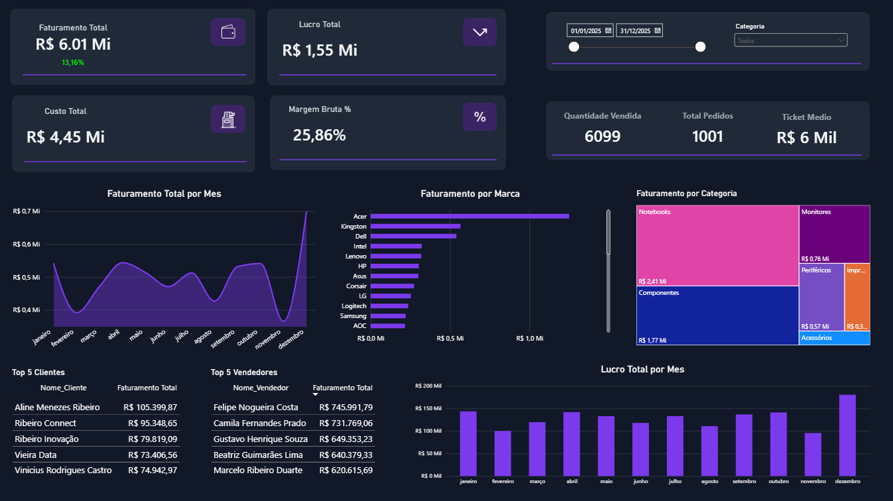
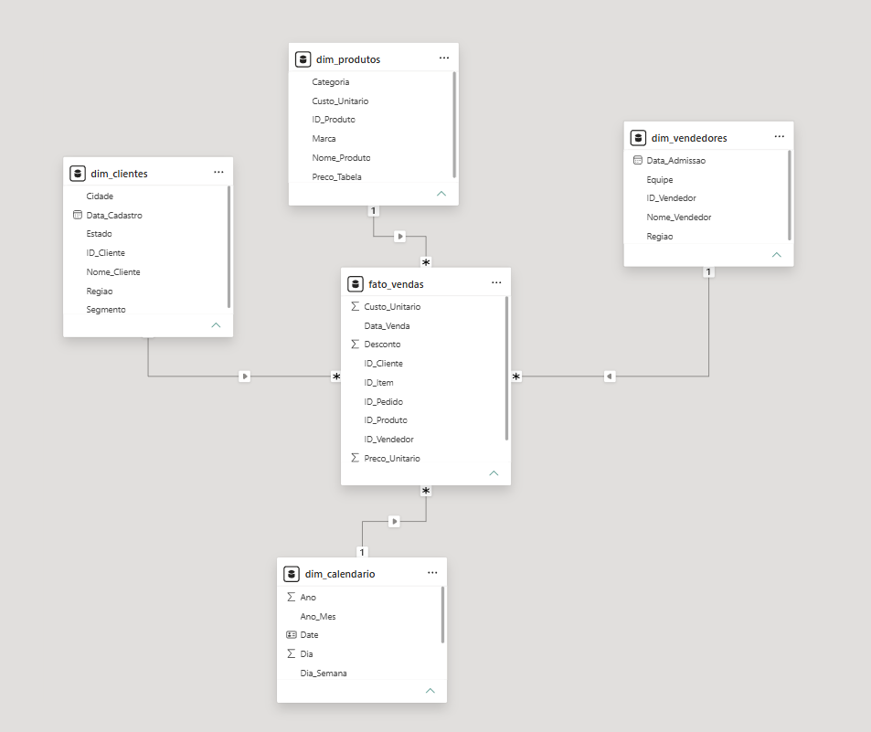

# Dashboard de Vendas - Eletrônicos e Informática

Projeto de **Data Analytics com Power BI**, desenvolvido para analisar o desempenho comercial de uma empresa fictícia do varejo de eletrônicos e informática.

O dashboard permite acompanhar indicadores de faturamento, custos, lucratividade, vendas e desempenho comercial, além de analisar resultados por período, marca, categoria, clientes e vendedores.

## Dashboard



## Objetivos do Projeto

- Analisar o desempenho comercial por meio de indicadores e visualizações.
- Acompanhar faturamento, custos, lucro e margem bruta.
- Comparar o faturamento atual com o mês anterior.
- Identificar marcas, categorias, clientes e vendedores de destaque.
- Aplicar conhecimentos de tratamento, modelagem e visualização de dados em um projeto independente.

## Ferramentas e Tecnologias

- **Power BI Desktop:** criação do dashboard e dos indicadores.
- **Power Query:** limpeza, transformação e preparação dos dados.
- **Linguagem M:** edição de consultas no Editor Avançado e criação de parâmetros.
- **DAX:** criação de medidas, tabela calendário e cálculos de análise temporal.
- **Modelagem dimensional:** organização dos dados utilizando o modelo estrela.

## Estrutura do Projeto

```text
powerbi-dashboard-vendas-eletronico/
├── data/
│   ├── fato_vendas.csv
│   ├── dim_produtos.csv
│   ├── dim_clientes.csv
│   └── dim_vendedores.csv
├── dashboard_vendas_eletronicos.pbix
├── dashboard_preview.png
├── modelagem.png
└── README.md
```

## Base de Dados

O projeto utiliza quatro arquivos CSV para organizar as informações comerciais:

| Arquivo | Descrição |
|---|---|
| `fato_vendas.csv` | Registros das vendas realizadas |
| `dim_produtos.csv` | Informações dos produtos |
| `dim_clientes.csv` | Informações dos clientes |
| `dim_vendedores.csv` | Informações dos vendedores |

## Etapas do Desenvolvimento

### 1. Importação e Tratamento dos Dados

Preparação das bases no Power Query, incluindo:

- Definição dos tipos de dados.
- Padronização de valores.
- Tratamento de dados ausentes e duplicados.
- Desenvolvimento de consultas utilizando a linguagem M.
- Criação de parâmetros para facilitar a configuração dos caminhos dos arquivos.

### 2. Modelagem de Dados

- Estruturação do modelo estrela.
- Criação de relacionamentos entre a tabela fato e as dimensões.
- Configuração dos relacionamentos de um para muitos (1:N).
- Utilização de direção de filtro única, das dimensões para a tabela fato.

**Modelo de Dados**



### 3. Tabela Calendário

Criação de uma dimensão calendário em DAX com informações de data, ano, mês, número do mês, ano-mês, trimestre, dia e dia da semana.

A tabela foi relacionada à data da venda na tabela fato, marcada como tabela de datas e configurada para exibir os meses em ordem cronológica.

### 4. Medidas DAX

Criação de medidas para análise dos principais indicadores:

- Faturamento Total
- Custo Total
- Lucro Total
- Margem Bruta (%)
- Quantidade Vendida
- Total de Pedidos
- Ticket Médio
- Faturamento do Mês Anterior
- Variação do Faturamento (%)

### 5. Desenvolvimento do Dashboard

Construção de uma página de visão geral com cartões de indicadores, gráficos e tabelas para facilitar a análise dos resultados comerciais.

**Indicadores e visualizações:**

- Cartões de faturamento, custos, lucro, margem, quantidade vendida, pedidos e ticket médio.
- Gráfico de área para análise do faturamento mensal.
- Gráfico de barras empilhadas para faturamento por marca.
- Treemap para faturamento por categoria.
- Gráfico de colunas empilhadas para lucro mensal.
- Tabela com Top 5 clientes por faturamento.
- Tabela com Top 5 vendedores por faturamento.
- Segmentações por data e categoria de produto.

## Principais Análises

O dashboard permite explorar questões como:

- Como o faturamento e o lucro evoluem ao longo dos meses?
- Qual é a margem bruta obtida nas vendas?
- Quais marcas e categorias geram maior faturamento?
- Quais clientes apresentam maior contribuição para as vendas?
- Quais vendedores possuem melhor desempenho comercial?
- Como o faturamento se compara ao mês anterior?

## Como Utilizar o Projeto

1. Clone ou baixe este repositório.
2. Mantenha os arquivos CSV dentro da pasta `data`.
3. Abra o arquivo `dashboard_vendas_eletronicos.pbix` no Power BI Desktop.
4. Caso necessário, ajuste o parâmetro `CaminhoDados` no Power Query para apontar para a pasta `data` do seu computador.
5. Atualize os dados para carregar as informações a partir do caminho configurado.

## Aprendizados

Este projeto foi desenvolvido de forma independente, com o objetivo de praticar a construção de um dashboard desde a preparação dos dados até a apresentação dos indicadores.

A experiência permitiu consolidar conhecimentos em Power Query, linguagem M, modelagem dimensional, DAX, análise temporal e design de dashboards, além de exercitar a autonomia na tomada de decisões durante o desenvolvimento.

---

**Projeto desenvolvido para fins de estudo e portfólio em Data Analytics.**
